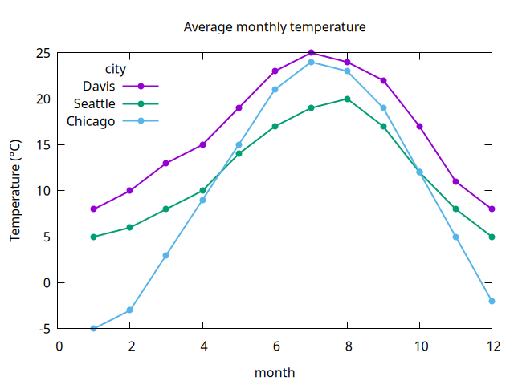
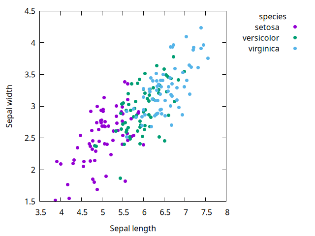
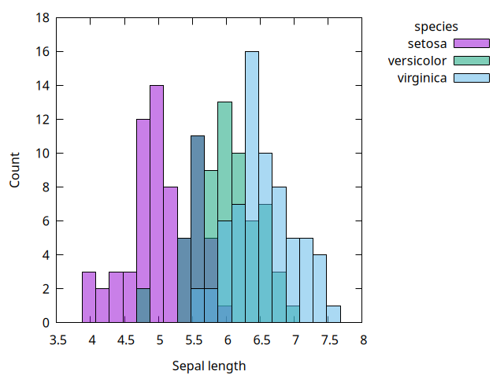
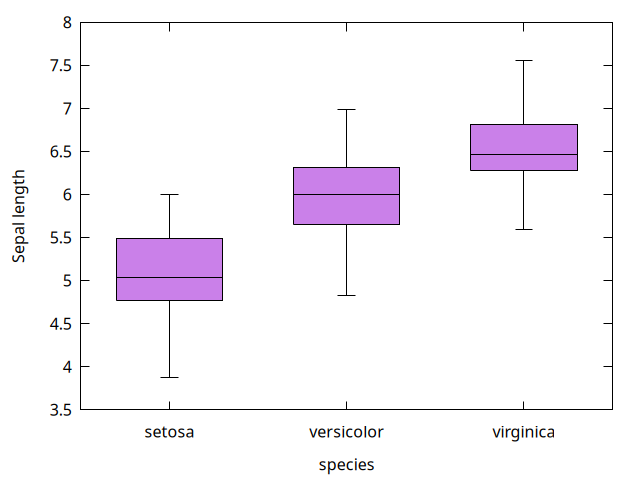
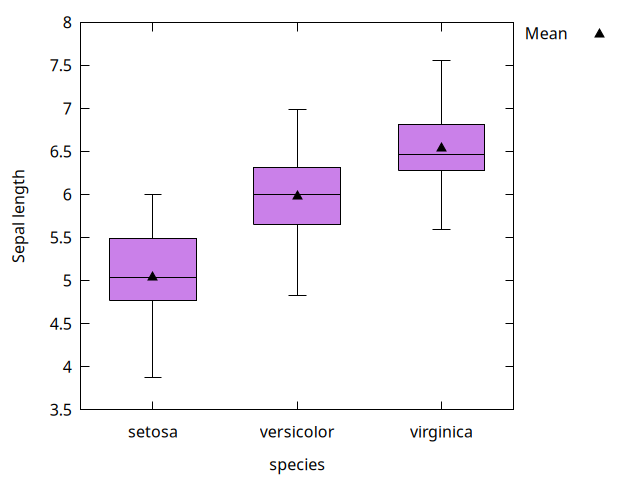

# gnuplot-dataframe

Plot [dataframes](https://github.com/hinkelman/dataframe) with [gnuplot](http://gnuplot.info) from Chez Scheme. Uses [gnuplot-pipe](https://github.com/hinkelman/gnuplot-pipe) to talk to gnuplot.

The API is loosely modeled on base R plotting: one procedure per plot type, column names for the data, and options for labels, legends, and output. Like `ggplot2`, a `'group` column splits the data into colored series with a legend.

## Requirements

[gnuplot](http://gnuplot.info) 5.0 or later (inline datablocks were added in 5.0). Tested with gnuplot 6.0 and Chez Scheme 10.3.

## Installation

```
$ akku install gnuplot-dataframe
```

## Quick start

```scheme
(import (dataframe)
        (gnuplot-dataframe))

(define temps
  (make-df* (month 1 2 3 4 1 2 3 4)
            (city "Davis" "Davis" "Davis" "Davis"
                  "Chicago" "Chicago" "Chicago" "Chicago")
            (temp 8 10 13 15 -5 -3 3 9)))

;; opens a gnuplot window
(plot-lines temps 'month 'temp 'group 'city 'points #t)

;; writes a file instead
(plot-lines temps 'month 'temp 'group 'city 'points #t
            'ylabel "Temperature (°C)"
            'output "temps.png")
```

The code from the original motivating example

```scheme
(gp:call/gnuplot
 (gp:send "set key top left")
 (gp:send "set xlabel 'month'")
 (gp:send "set ylabel 'Avg. temp'")
 (gp:send "set style data linespoints")
 (gp:plot (map (lambda (c) ...) (remove-duplicates ($ df 'city)))))
```

becomes

```scheme
(plot-lines df 'month 'temp 'group 'city 'points #t
            'key "top left" 'ylabel "Avg. temp")
```

See [examples/examples.ss](examples/examples.ss) for the code that made the images below.

| | |
|---|---|
|  |  |
|  |  |
|  |  |

## Plot procedures

Columns are given as symbols. Options come after the columns as name/value pairs, e.g., `'group 'city 'title "Temperature"`. An unknown option name is an error.

Each `plot-*` procedure draws one layer. To draw several layers on the same axes, see [Layers](#layers).

| Procedure | Draws | Notes |
|---|---|---|
| `(plot-points df x y . opts)` | scatter plot | |
| `(plot-lines df x y . opts)` | line plot | rows are sorted by `x` within each group |
| `(plot-bars df x y . opts)` | bar chart of `y` at each value of `x` | `y` is plotted as given, like `geom_col`, not counted; groups are drawn side by side |
| `(plot-histogram df x . opts)` | histogram of `x` | groups overlap with transparent fill |
| `(plot-boxplot df x y . opts)` | boxplot of `y` for each value of `x` | pass `#f` for `x` for a single box; groups are drawn side by side |

If `x` holds strings (or any non-numeric values), it is treated as categorical: values are placed at evenly spaced positions in order of first appearance and labelled on the x axis. `plot-bars` and `plot-boxplot` always treat `x` as categorical.

Missing values (`'na`) are skipped. In `plot-lines`, a missing `y` breaks the line.

### Options for all plot types

| Option | Value | Default |
|---|---|---|
| `'group` | column name; one series per unique value, with a legend | none |
| `'color` | color name or `"#rrggbb"`; overrides the colors from `'group` | gnuplot's color sequence |
| `'label` | legend entry for an ungrouped layer | none |
| `'title` | string | none |
| `'xlabel`, `'ylabel` | string | the column name (`"Count"` for a histogram's y) |
| `'key` | legend position as a gnuplot string, e.g., `"top left"`, `"bottom right"`, `"outside right top"`, or `#f` to hide it | `"outside right top"` when grouped, otherwise hidden |
| `'grid` | `#t` to draw grid lines | `#f` |
| `'xrange`, `'yrange` | list of two numbers, where `#f` means autoscale, e.g., `'(0 #f)` | autoscale |
| `'logscale` | `'x`, `'y`, or `'xy` | none |
| `'output` | file name ending in `.png`, `.svg`, `.pdf`, or `.txt` (ASCII art) | open a window |
| `'size` | `'(width height)` in pixels (100 pixels per inch for pdf) | gnuplot's default |
| `'commands` | list of extra gnuplot commands, sent just before plotting | `'()` |

### Options for specific plot types

| Procedure | Option | Value | Default |
|---|---|---|---|
| `plot-points` | `'pointsize` | number | `1` |
| | `'pointtype` | gnuplot point type number | `7` (filled circle) |
| `plot-lines` | `'points` | `#t` to also draw points | `#f` |
| | `'linewidth` | number | `2` |
| | `'sort` | `#f` to connect rows in data order | `#t` |
| `plot-histogram` | `'bins` | number of bins | Sturges' rule, as in R's `hist` |
| | `'binwidth` | bin width; overrides `'bins` | |

## Layers

`plot-layers` draws several layers on the same axes. Each `layer-*` procedure takes the same arguments as the matching `plot-*` procedure, and can use its own dataframe:

| Layer | Same arguments as |
|---|---|
| `(layer-points df x y . opts)` | `plot-points` |
| `(layer-lines df x y . opts)` | `plot-lines` |
| `(layer-bars df x y . opts)` | `plot-bars` |
| `(layer-histogram df x . opts)` | `plot-histogram` |
| `(layer-boxplot df x y . opts)` | `plot-boxplot` |

Pass the layers to `plot-layers`, followed by the plot options:

```scheme
(plot-layers (layer-points flowers 'length 'width 'group 'species)
             (layer-lines fits 'length 'width 'group 'species)
             'xlabel "Sepal length" 'ylabel "Sepal width")
```

Options are split between layers and the plot:

- **Layer options** describe the data and how it's drawn: `'group`, `'color`, `'label`, and the options for that plot type (e.g., `'pointsize`, `'bins`).
- **Plot options** describe the whole figure: `'title`, `'xlabel`, `'ylabel`, `'key`, `'grid`, `'xrange`, `'yrange`, `'logscale`, `'output`, `'size`, and `'commands`.

Giving an option to the wrong one is an error. (The `plot-*` shortcuts accept both kinds and sort them out.)

How layers combine:

- Layers are drawn in order, so later layers are on top.
- Axis labels default to the first layer's columns.
- A group value has the same color in every layer and appears once in the legend, with the first layer's symbol. In the example above, each species' points and fitted line share a color.
- An ungrouped layer appears in the legend only if it has a `'label`.
- If any layer has a categorical x (bars, boxplots, or text values), every layer is placed on the same category positions. For example, points of group means can be drawn over a boxplot:

```scheme
(plot-layers (layer-boxplot flowers 'species 'length)
             (layer-points species-means 'species 'avg
                           'color "black" 'pointtype 9 'label "Mean"))
```



A histogram has a numeric x axis, so it can't be combined with a categorical layer.

## Going beyond the options

Anything else gnuplot can do is available through `'commands`:

```scheme
(plot-bars df 'country 'gdp
           'commands '("set xtics rotate by 45 right"
                       "set format y '%.0f'"))
```

To see the script that a plot sends to gnuplot, set `plot-dry-run` to `#t`. The plot procedure then returns the script as a string instead of running gnuplot. This is a good way to learn gnuplot commands, or to save a script and edit it by hand.

```scheme
> (parameterize ([plot-dry-run #t])
    (display (plot-points temps 'month 'temp)))
set xlabel 'month'
set ylabel 'temp'
unset key
$d1 << EOD
1 8
...
EOD
plot $d1 using 1:2 with points pt 7 ps 1 notitle
```

## Running the tests

The tests check the generated scripts, so gnuplot is not needed to run them.

```
$ scheme --program tests/test-gnuplot-dataframe.sps
```
