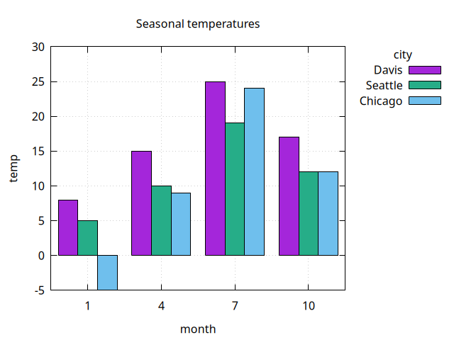
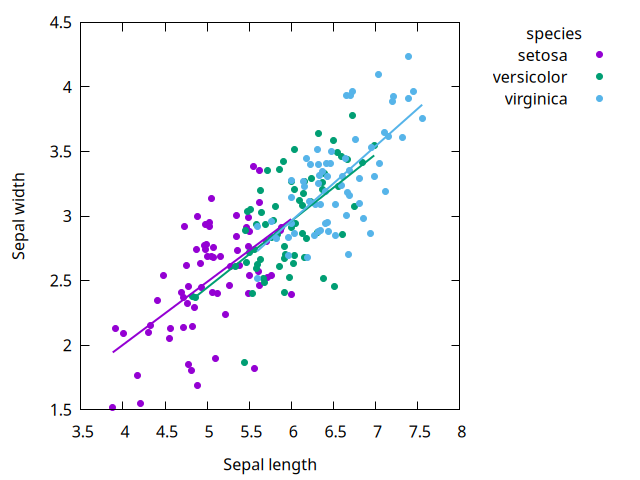
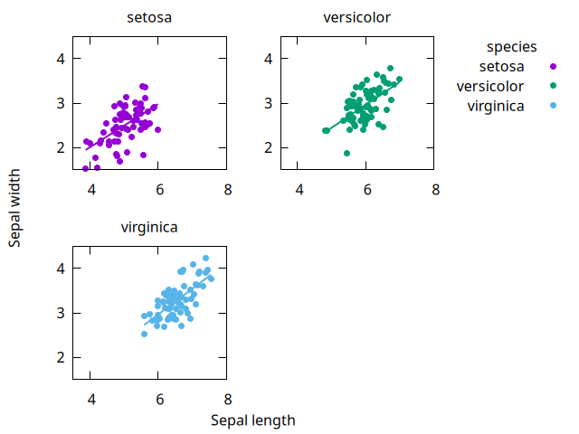
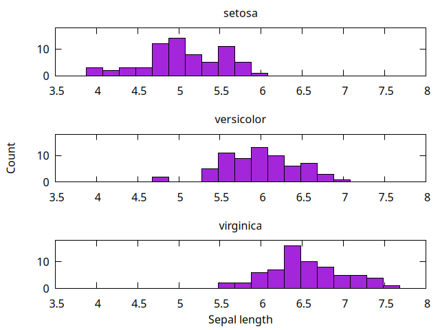

# gnuplot-dataframe

Plot [dataframes](https://github.com/hinkelman/dataframe) with [gnuplot](http://gnuplot.info) from Chez Scheme. Uses [gnuplot-pipe](https://github.com/hinkelman/gnuplot-pipe) to talk to gnuplot.

The API is loosely modeled on base R plotting: one procedure per plot type, column names for the data, and options for labels, legends, and output. Like `ggplot2`, a `'group` column splits the data into colored series with a legend, layers can be combined on the same axes, and a `'facet` column splits a plot into panels.

## Documentation

Full API documentation is available at [hinkelman.github.io/gnuplot-dataframe](https://hinkelman.github.io/gnuplot-dataframe).

## Requirements

[gnuplot](http://gnuplot.info) 5.2.6 or later. Tested with gnuplot 6.0 and Chez Scheme 10.3.

## Installation

Clone this repository and its dependencies, [dataframe](https://github.com/hinkelman/dataframe) and [gnuplot-pipe](https://github.com/hinkelman/gnuplot-pipe):

```
$ git clone https://github.com/hinkelman/gnuplot-dataframe
$ git clone https://github.com/hinkelman/dataframe
$ git clone https://github.com/hinkelman/gnuplot-pipe
```

Then add the three directories to Chez Scheme's library path, e.g., in your shell profile:

```
$ export CHEZSCHEMELIBDIRS="/path/to/gnuplot-dataframe:/path/to/dataframe:/path/to/gnuplot-pipe:$CHEZSCHEMELIBDIRS"
```

Those libraries have dependencies of their own, which also need to be on the library path: gnuplot-pipe uses SRFI 1 and SRFI 13 (e.g., from [chez-srfi](https://github.com/arcfide/chez-srfi)), and dataframe uses `(slib format)`.

## Import

```scheme
(import (dataframe)
        (gnuplot-dataframe))
```

## Quick Example

```scheme
(define temps
  (make-df* (month 1 2 3 4 1 2 3 4)
            (city "Davis" "Davis" "Davis" "Davis"
                  "Chicago" "Chicago" "Chicago" "Chicago")
            (temp 8 10 13 15 -5 -3 3 9)))

;; opens a gnuplot window
(plot-lines temps 'month 'temp 'group 'city 'points #t)

;; writes a file instead
(plot-lines temps 'month 'temp 'group 'city 'points #t
            'ylabel "Temperature (°C)"
            'output "temps.png")

;; layers on the same axes
(plot-layers (layer-points temps 'month 'temp 'group 'city)
             (layer-lines temps 'month 'temp 'group 'city))

;; one panel per city
(plot-lines temps 'month 'temp 'facet 'city)
```

## Gallery

The code for these plots is in [examples/examples.ss](examples/examples.ss).

| | |
|---|---|
|  |  |
|  |  |
|  |  |
|  |  |

## Running the tests

The tests check the generated scripts, so gnuplot is not needed to run them.

```
$ scheme --program tests/test-gnuplot-dataframe.sps
```

## Building the documentation

The documentation site is built with [MkDocs](https://www.mkdocs.org/) and [Material for MkDocs](https://squidfunk.github.io/mkdocs-material/).

```
$ mkdocs serve      # preview at http://127.0.0.1:8000
$ mkdocs gh-deploy  # publish to the gh-pages branch
```
