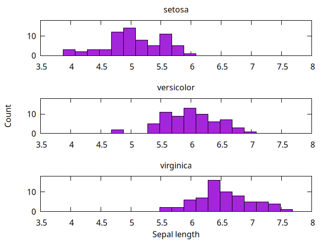
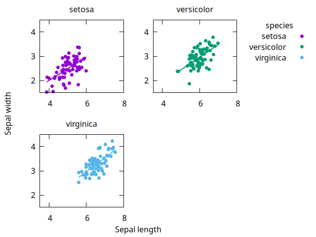

# Facets

Faceting draws one panel per value of a column, like `facet_wrap` in `ggplot2`. Pass the column to any plot with the `'facet` [plot option](options.md#plot-options):

```scheme
> (plot-histogram flowers 'length 'facet 'species 'facet-columns 1 'binwidth 0.2
                  'xlabel "Sepal length")
```



Faceting works with [layers](layers.md), too:

```scheme
> (plot-layers (layer-points flowers 'length 'width 'group 'species)
               (layer-lines fits 'length 'width 'group 'species)
               'facet 'species
               'xlabel "Sepal length" 'ylabel "Sepal width")
```



---

## Options

| Option | Value | Default |
|---|---|---|
| `'facet` | column name; one panel per unique value, in order of first appearance | none |
| `'facet-columns` | number of columns of panels | the smallest number that makes a square or wider grid |
| `'facet-scales` | `'fixed`, `'free`, `'free-x`, or `'free-y` | `'fixed` |

With `'fixed` scales, every panel has the same axis ranges, so panels can be compared directly. `'free` lets each panel's axes fit its own data. `'free-x` and `'free-y` free one axis and keep the other fixed. A categorical x axis always has the same categories in every panel.

---

## How panels are drawn

- **Layers without the facet column** are drawn in every panel. For example, a dataframe holding a reference line can be layered over faceted data.
- **Shared across panels:** group colors, categorical x positions, and histogram bins all come from the full data.
- **Legend:** one legend, to the right of the panels. A `'key` string such as `"top left"` instead places the legend inside the last panel, and `#f` hides it.
- **Labels:** the x and y axis labels are drawn once, centered on the panels. Each panel is titled with its facet value, and `'title` goes above all the panels.
- **Ticks:** with fixed scales, tick spacing is chosen to suit the panel size. To set it yourself, use `'commands`, e.g., `'commands '("set xtics 1")`.

!!! note
    Panels are drawn with gnuplot's `set multiplot`. Some `'commands` that change the page layout, such as `set size` or `set origin`, don't work with facets.
