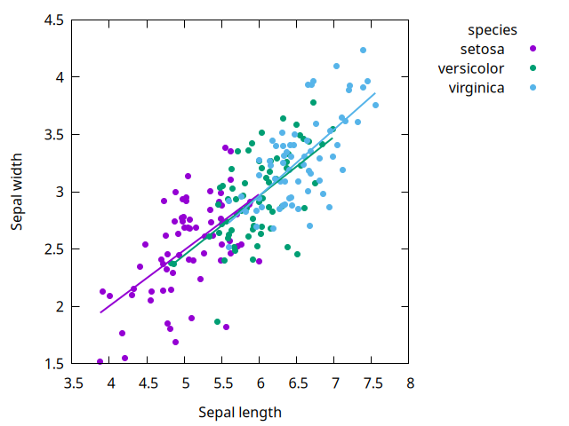
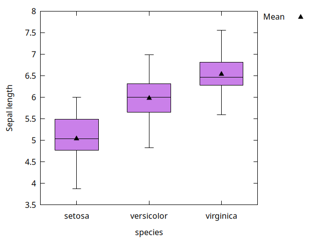

# Layers

`plot-layers` draws several layers on the same axes, like adding geoms in `ggplot2`. Each layer can use its own dataframe.

---

## `(plot-layers layer ... . opts)`

**draws:** each `layer` in order, so later layers are on top, followed by the [plot options](options.md#plot-options).

```scheme
> (plot-layers (layer-points flowers 'length 'width 'group 'species)
               (layer-lines fits 'length 'width 'group 'species)
               'xlabel "Sepal length" 'ylabel "Sepal width")
```



Here `fits` has the two end points of a least-squares line for each species. See [examples/examples.ss](https://github.com/hinkelman/gnuplot-dataframe/blob/main/examples/examples.ss) for how it's computed.

---

## `(layer-points df x y . opts)`
## `(layer-lines df x y . opts)`
## `(layer-bars df x y . opts)`
## `(layer-histogram df x . opts)`
## `(layer-boxplot df x y . opts)`

**returns:** a layer for `plot-layers`. Each takes the same arguments as the matching [plot procedure](plots.md), but only [layer options](options.md#layer-options). Giving a layer a plot option, such as `'title`, is an error.

```scheme
> (define species-means
    (dataframe-aggregate* flowers (species) (avg (length) (mean length))))

> (plot-layers (layer-boxplot flowers 'species 'length)
               (layer-points species-means 'species 'avg
                             'color "black" 'pointtype 9 'pointsize 1.5
                             'label "Mean")
               'ylabel "Sepal length")
```



---

## How layers combine

- **Axis labels** default to the first layer's columns.
- **Colors:** a group value has the same color in every layer, so each species' points and fitted line match above.
- **Legend:** each group value appears once, with the first layer's symbol. An ungrouped layer appears only if it has a `'label`. The legend title is the group column, if all grouped layers use the same one.
- **Categorical x:** if any layer has a categorical x (bars, boxplots, or text values), every layer is placed on the same category positions, in order of first appearance across layers. That's how the means above line up with the boxes.

!!! note
    A histogram has a numeric x axis, so it can't be combined with a categorical layer.
