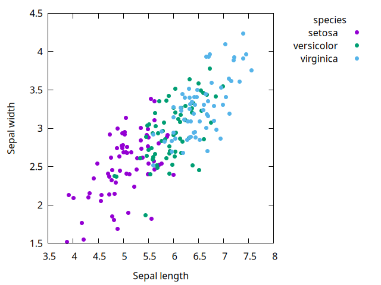
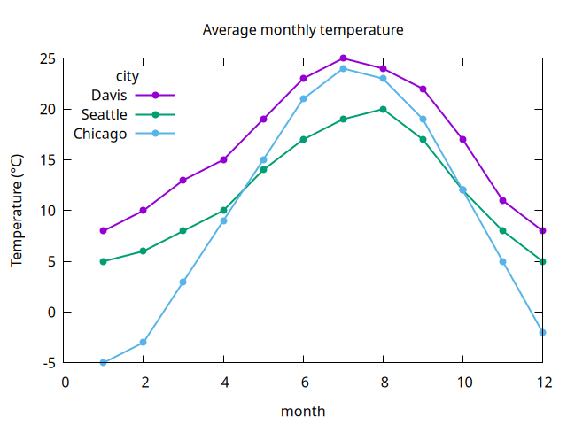
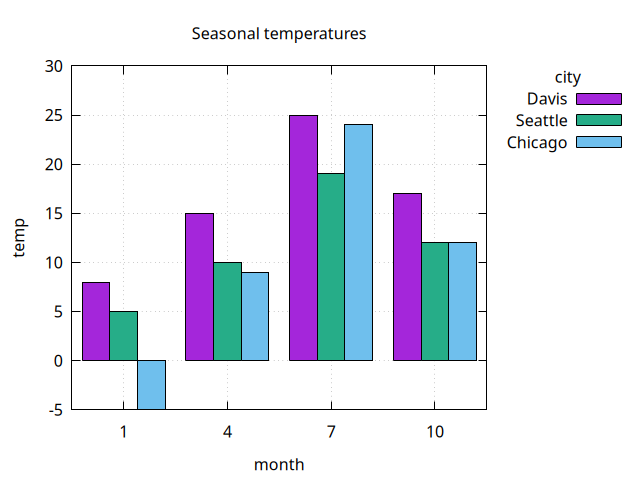
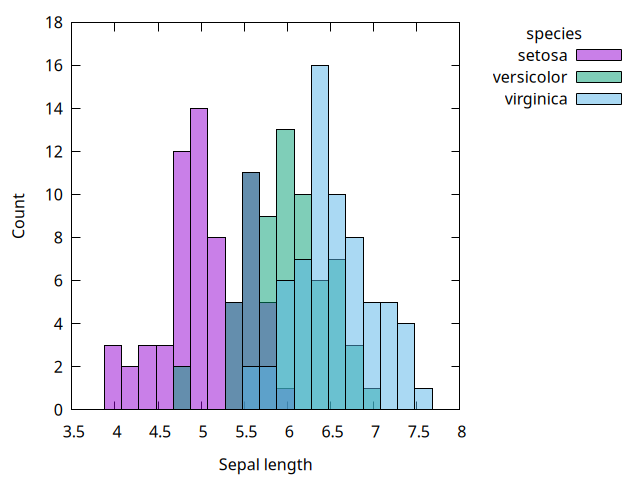
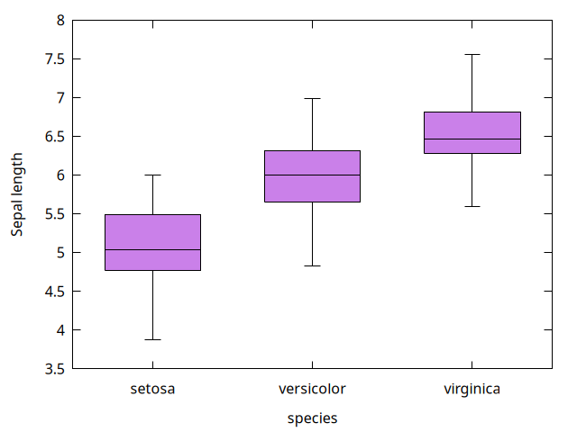

# Plots

Each `plot-*` procedure draws one layer from a dataframe. Columns are given as symbols, and [options](options.md) follow as name/value pairs:

```scheme
(plot-points df 'x 'y 'group 'trt 'title "Response")
```

Each procedure opens a gnuplot window, or writes a file when `'output` is given. Its return value is unspecified, unless [`plot-dry-run`](scripts.md) is `#t`.

If `x` holds strings (or any non-numeric values), it is treated as categorical: values are placed at evenly spaced positions in order of first appearance and labelled on the x axis. `plot-bars` and `plot-boxplot` always treat `x` as categorical.

Missing values (`'na`) are skipped.

The examples on this page use the data defined in [examples/examples.ss](https://github.com/hinkelman/gnuplot-dataframe/blob/main/examples/examples.ss).

---

## `(plot-points df x y . opts)`

**draws:** a scatter plot of column `y` against column `x`.

**options:** `'pointsize` (default `1`) and `'pointtype` (a gnuplot point type number; default `7`, a filled circle), plus the [options for all plots](options.md).

```scheme
> (plot-points flowers 'length 'width 'group 'species
               'xlabel "Sepal length" 'ylabel "Sepal width")
```



---

## `(plot-lines df x y . opts)`

**draws:** a line plot of column `y` against column `x`. Rows are sorted by `x` within each group. A missing `y` value breaks the line.

**options:** `'points` (`#t` to also draw points; default `#f`), `'linewidth` (default `2`), `'pointtype` and `'pointsize` (for the points), and `'sort` (`#f` to connect rows in data order; default `#t`), plus the [options for all plots](options.md).

```scheme
> (plot-lines temps 'month 'temp 'group 'city 'points #t
              'title "Average monthly temperature"
              'ylabel "Temperature (°C)" 'key "top left")
```



---

## `(plot-bars df x y . opts)`

**draws:** a bar chart with a bar of height `y` at each value of `x`. Values of `y` are plotted as given, like `geom_col` in `ggplot2`, not counted. With `'group`, the bars for each category are drawn side by side.

**options:** `'fill` (default `0.85`), `'border` (default `#t`), and `'width` (total width at each category; default `0.8`), plus the [options for all plots](options.md). See [Fill and border](options.md#fill-and-border).

```scheme
> (plot-bars (dataframe-filter* temps (month) (member month '(1 4 7 10)))
             'month 'temp 'group 'city
             'title "Seasonal temperatures" 'grid #t)
```



---

## `(plot-histogram df x . opts)`

**draws:** a histogram of the numeric column `x`. With `'group`, the histograms of each group overlap, with transparent fill, and share the same bins.

**options:** `'bins` (number of bins; default from Sturges' rule, as in R's `hist`), `'binwidth` (overrides `'bins`), `'fill`, and `'border`, plus the [options for all plots](options.md). The y axis label defaults to `"Count"`.

```scheme
> (plot-histogram flowers 'length 'group 'species 'binwidth 0.2
                  'xlabel "Sepal length")
```



---

## `(plot-boxplot df x y . opts)`

**draws:** a boxplot of column `y` for each value of column `x`. Pass `#f` for `x` to draw a single box of all `y` values. With `'group`, the boxes for each category are drawn side by side.

**options:** `'fill` (default `0.5`), `'border` (default `#t`), `'width` (total width at each category; default `0.6`), and `'pointtype` and `'pointsize` (for the outliers), plus the [options for all plots](options.md). See [Fill and border](options.md#fill-and-border).

```scheme
> (plot-boxplot flowers 'species 'length 'ylabel "Sepal length")
```


