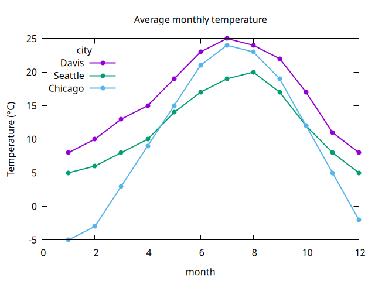
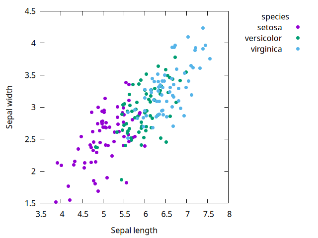
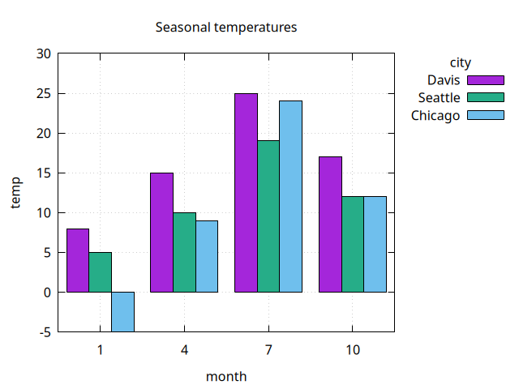
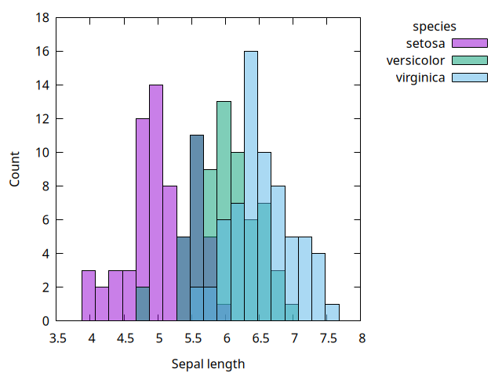
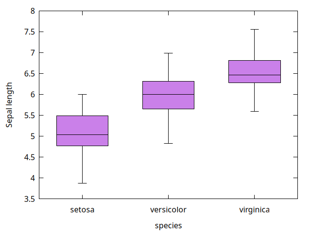
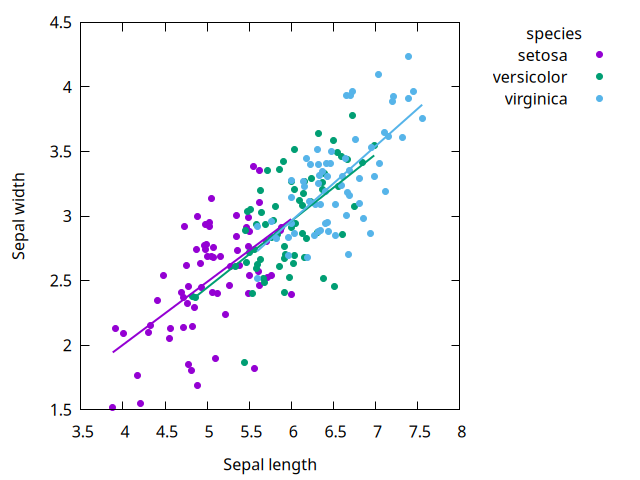

# Scheme gnuplot-dataframe Library

Plot [dataframes](https://hinkelman.github.io/dataframe) with [gnuplot](http://gnuplot.info) from Chez Scheme.

The API is loosely modeled on base R plotting: one procedure per plot type, column names for the data, and options for labels, legends, and output. Like `ggplot2`, a `'group` column splits the data into colored series with a legend, and layers can be combined on the same axes.

[GitHub](https://github.com/hinkelman/gnuplot-dataframe) · [dataframe](https://hinkelman.github.io/dataframe) · [gnuplot-pipe](https://github.com/hinkelman/gnuplot-pipe)

---

## Quick Example

```scheme
(import (dataframe)
        (gnuplot-dataframe))

(define temps
  (make-df* (month 1 2 3 4 1 2 3 4)
            (city "Davis" "Davis" "Davis" "Davis"
                  "Chicago" "Chicago" "Chicago" "Chicago")
            (temp 8 10 13 15 -5 -3 3 9)))

;; opens a gnuplot window
(plot-lines temps 'month 'temp 'group 'city 'points #t)

;; writes a file instead
(plot-lines temps 'month 'temp 'group 'city 'points #t
            'ylabel "Temperature (°C)"
            'output "temps.png")
```

## Gallery

The code for these plots is in [examples/examples.ss](https://github.com/hinkelman/gnuplot-dataframe/blob/main/examples/examples.ss).

| | |
|---|---|
|  |  |
|  |  |
|  |  |

## API Overview

| Section | Procedures |
|---|---|
| [Plots](api/plots.md) | `plot-points`, `plot-lines`, `plot-bars`, `plot-histogram`, `plot-boxplot` |
| [Options](api/options.md) | `'group`, `'title`, `'key`, `'output`, … |
| [Layers](api/layers.md) | `plot-layers`, `layer-points`, `layer-lines`, `layer-bars`, `layer-histogram`, `layer-boxplot` |
| [gnuplot Scripts](api/scripts.md) | `plot-dry-run`, `'commands` |
